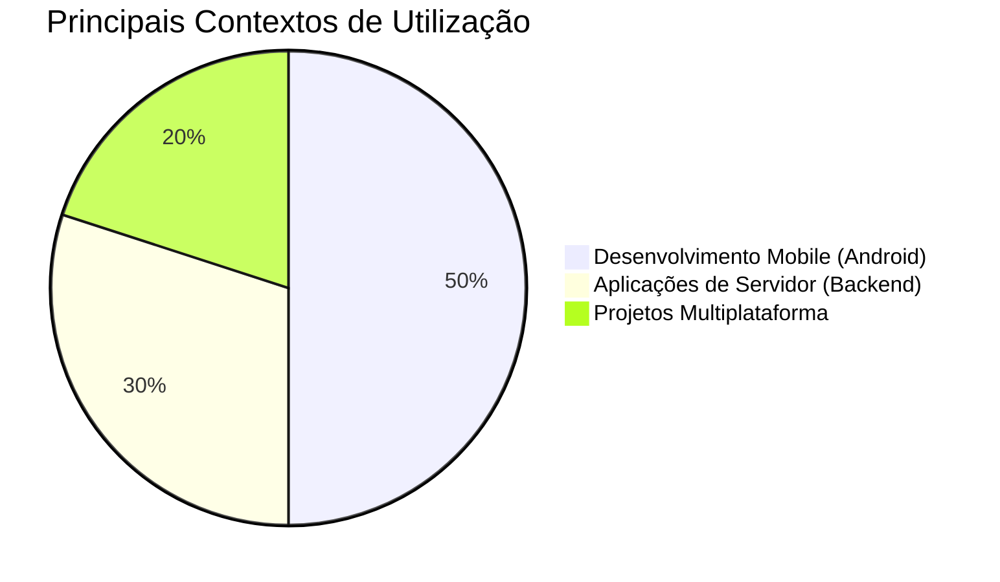

# 📚 Resumo 01 - Introdução à linguagem Kotlin

---

## 🎯 Objetivos da Aula

* Conhecer a origem e o contexto histórico do Kotlin
* Compreender a evolução da linguagem ao longo do tempo
* Identificar as principais características e os princípios da sua criação
* Compreender a relação entre Kotlin e Java
* Reconhecer a importância do Kotlin no ecossistema atual de desenvolvimento
* Identificar os principais contextos de utilização da linguagem

---

## 📜 Linha do Tempo do Kotlin

```mermaid
    title Evolução Histórica do Kotlin
    2010 : Início do desenvolvimento<br>na JetBrains
    2011 : Apresentação pública<br>do projeto
    2012 : Linguagem torna-se<br>código aberto (Open Source)
    2016 : Lançamento da<br>versão 1.0 (Estável)
    2017 : Apoio oficial do<br>Google para Android
    2019 : Google anuncia<br>abordagem Kotlin-first
    Atual : Expansão para o<br>ecossistema Multiplataforma
```

---

## 🧩 Origem e Contexto Histórico

### O Início na JetBrains

* **2010** – O desenvolvimento começou na **JetBrains**, empresa amplamente conhecida pelas suas ferramentas de desenvolvimento, como o IntelliJ IDEA.
* A equipa procurava uma linguagem moderna que melhorasse a produtividade dos programadores, sobretudo no ecossistema Java e da JVM (Java Virtual Machine).
* O objetivo nunca foi abandonar toda a infraestrutura existente, mas sim criar uma linguagem que pudesse aproveitar esse ecossistema.

> 💡 **Curiosidade**: O Kotlin não surgiu porque o Java deixou de ser útil. Surgiu para oferecer uma alternativa moderna, focada em produtividade e segurança, capaz de trabalhar em conjunto com o Java.

---

## 🌱 Primeiros Passos e Definição

### O Que é o Kotlin?

* Uma linguagem de **propósito geral**, que não está limitada a uma única finalidade.
* **Estaticamente tipada**: os tipos dos dados são conhecidos e verificados pelo compilador, ajudando a detetar erros precocemente.
* **Multiparadigma**: suporta simultaneamente conceitos de programação orientada a objetos e programação funcional.

---

## 🔄 Os Desafios do Ecossistema

### Por que razão surgiu o Kotlin?

* **Verbosidade do Java**: determinadas operações na linguagem antiga exigiam um volume excessivo de linhas de código.
* **Insegurança de Nulos**: os programadores sofriam constantemente com erros em tempo de execução, como o infame `NullPointerException`.
* **Dificuldade de Migração**: substituir sistemas Java por completo seria dispendioso. A solução era uma linguagem nova, mas 100% interoperável.

> 🌐 **Contexto**: A comunidade pedia modernização, funcionalidades expressivas e código conciso, sem abrir mão das bibliotecas maduras já consolidadas pelas empresas.

---

## 🚀 Consolidação e Adoção em Massa

### O Casamento com o Android

* **2017** – O Kotlin passa a ter **suporte oficial** do Google como linguagem de desenvolvimento Android, alavancando drasticamente a sua adoção.
* **2019** – O Google anuncia a abordagem **Kotlin-first**, garantindo que o desenvolvimento para o sistema daria prioridade ao Kotlin (documentação, ferramentas, exemplos).

---

## 📊 Kotlin como Código Aberto

### Abertura para a Comunidade

* **2012** – A JetBrains disponibiliza o projeto como **open source** (código aberto).
* Permitiu a participação ativa da comunidade no seu desenvolvimento.
* Possibilitou que o código-fonte pudesse ser utilizado, estudado e modificado sob os termos da licença pública.

---

## 🔄 Nova Fase: Ecossistema Multiplataforma

### Muito Além da JVM

O Kotlin continua a evoluir para não ser apenas focado em JVM e Android:

* **Aplicações de Servidor (Backend)**: fortemente impulsionado pela adoção em frameworks como Spring Boot.
* **Kotlin Multiplatform (KMP)**: permite partilhar o mesmo código entre diferentes plataformas (Android, iOS, Desktop), reduzindo a duplicação de regras de negócio.
* **Expansão Web**: compilação nativa abrangendo JavaScript e WebAssembly.

---

## 🌍 Exemplos de Uso do Kotlin

### Onde o Kotlin Brilha



### Casos de Uso Específicos

* **Aplicações Android** – Principal escolha atual para criação de apps mobile nativas.
* **Backend Corporativo** – Implementação de regras de negócio, APIs e serviços empresariais.
* **Partilha de Código (Multiplatform)** – Arquiteturas onde iOS e Android partilham o mesmo núcleo de código lógico, mantendo UIs nativas.

---

## 📈 Principais Características da Linguagem

| Característica | Significado |
| --- | --- |
| **Tipagem estática** | Os tipos são verificados no momento da compilação. |
| **Sintaxe concisa** | Permite expressar operações com menos código (ex: `println("Olá, mundo!")`). |
| **Null Safety** | O sistema de tipos ajuda a prevenir erros relacionados com valores nulos. |
| **Interoperabilidade** | Capacidade nativa de utilizar bibliotecas e código Java no mesmo projeto. |
| **Multiparadigma** | Suporta tanto classes/objetos como funções de ordem superior/lambdas. |
| **Multiplataforma** | Permite partilhar código entre plataformas distintas (Mobile, Web, Desktop). |

---

## 🎓 A Relação Estratégica com o Java

### Interoperabilidade Total

* Na JVM, o Kotlin é compilado para o mesmo *bytecode* que o Java, sendo executado pela mesma máquina virtual.
* Um mesmo projeto pode ter ficheiros `.java` e `.kt` a funcionar perfeitamente em simultâneo.
* **Vantagem Competitiva**: Permite a modernização de projetos antigos de forma gradual, sem necessitar de reescrever do zero.

---                           

### 💎 Curiosidade Final

Para entender facilmente a interoperabilidade com o Java, pense nesta analogia:

> "Imagina que o Java é uma infraestrutura rodoviária já construída e utilizada por milhões de pessoas. O Kotlin permite utilizar grande parte dessa infraestrutura, mas oferece um veículo mais moderno e uma forma muito melhor de conduzir e organizar a viagem."