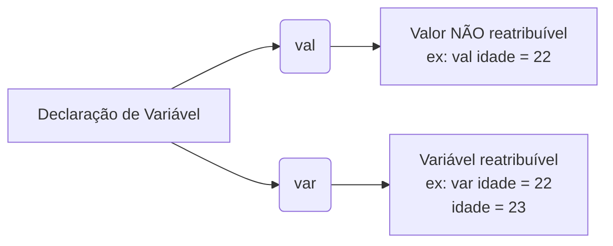

# 📚 Resumo 03 - Variáveis, Tipos de Dados e Comentários em Kotlin

---

## 🎯 Objetivos da Aula

* Compreender o conceito de variável e a sua utilização em Kotlin
* Distinguir as declarações `val` e `var`
* Compreender a inferência de tipos e a declaração explícita
* Conhecer os principais tipos de dados da linguagem
* Identificar os diferentes tipos de comentários
* Utilizar *templates* de *strings* para apresentar dados de forma dinâmica

---

## 📦 Variáveis em Kotlin: `val` vs `var`

Uma variável permite associar um nome a um valor, armazenando dados durante a execução do programa. Em Kotlin, a declaração é feita através de duas palavras-chave principais:



* **`val` (Valor)**: Utiliza-se quando não pretendemos atribuir outro valor à variável depois da sua inicialização. (Atenção: o objeto armazenado pode ser mutável, mas a referência da variável não muda).
* **`var` (Variável)**: Utiliza-se quando precisamos de alterar/reatribuir o valor associado à variável ao longo do código.

> 💡 **Boa prática**: Prefere `val` sempre que não precisares de reatribuir um valor. Utiliza `var` apenas quando a alteração for estritamente necessária.

---

## 🔍 Inferência de Tipos vs Declaração Explícita

O Kotlin possui **tipagem estática** (os tipos são verificados pelo compilador). No entanto, não precisas de escrever o tipo o tempo todo.

### 1. Inferência de Tipos

O compilador identifica o tipo automaticamente com base no valor atribuído. O código fica mais conciso.

```kotlin
val nome = "Ana"       // Inferido como String
val idade = 20         // Inferido como Int
val altura = 1.75      // Inferido como Double
val estudante = true   // Inferido como Boolean

```

### 2. Declaração Explícita

O tipo é indicado manualmente utilizando o símbolo `:`. Pode tornar a intenção do código mais clara em certas situações.

```kotlin
val nome: String = "Ana"
val idade: Int = 20
val altura: Double = 1.75

```

> ⚠️ **Atenção**: Uma vez definido o tipo de uma variável (explícita ou implicitamente), ele **não muda**. Tentar atribuir uma *String* a uma variável *Int* resultará num erro de compilação.

---

## 🗂️ Principais Tipos de Dados

Os tipos determinam a natureza da informação que uma variável pode armazenar.

| Tipo | Descrição | Exemplo |
| --- | --- | --- |
| **Int** | Números inteiros | `val idade = 22` |
| **Double** | Números com casas decimais | `val altura = 1.85` |
| **Boolean** | Valores lógicos (verdadeiro/falso) | `val aprovado = true` |
| **Char** | Um único carácter (usa aspas simples) | `val inicial = 'T'` |
| **String** | Sequência de caracteres (usa aspas duplas) | `val nome = "Thayrony"` |

> 🌐 **Contexto (JVM)**: Ao contrário do Java (que separa tipos primitivos como `int` de classes *wrapper* como `Integer`), o Kotlin unifica isto. Na JVM, valores como `Int` ou `Double` são otimizados automaticamente para primitivos ou objetos dependendo da necessidade, simplificando a vida do programador.

---

## 💬 Comentários no Código

Os comentários são ignorados pelo compilador e servem para documentar o código e explicar decisões.

| Tipo de Comentário | Sintaxe | Exemplo |
| --- | --- | --- |
| **Linha** | `//` | `// Guarda o nome do utilizador` |
| **Bloco** | `/* ... */` | `/* Este programa guarda`<br>

<br>`informações do aluno */` |
| **Documentação (KDoc)** | `/** ... */` | `/** Calcula a soma de dois números */` |

---

## 📝 Templates de Strings

Permitem inserir valores de variáveis ou calcular expressões diretamente dentro de uma `String`, eliminando a necessidade de concatenações complexas.

* **Inserir Variável Simples (`$`)**:
```kotlin
val nome = "Ana"
println("Olá, $nome!") // Resultado: Olá, Ana!

```


* **Inserir Expressões (`${}`)**:
```kotlin
val idade = 20
println("No próximo ano terás ${idade + 1} anos.") // Resultado: No próximo ano terás 21 anos.

```

---

### 🎯 Desafio Prático

Cria um programa Kotlin que declare as seguintes informações sobre ti, utilizando **apenas `val**`:

* **Nome**: o teu nome.
* **Idade**: a tua idade.
* **Altura**: a tua altura em metros.
* **Estudante**: `true`.
* **Inicial**: a primeira letra do teu nome.

**Regra**: O programa deverá apresentar uma única mensagem na consola formatada com **templates de strings**. Utiliza a sintaxe `${}` para calcular e exibir a idade que terás no próximo ano diretamente na frase impressa. Teste o código e verifique os tipos inferidos!