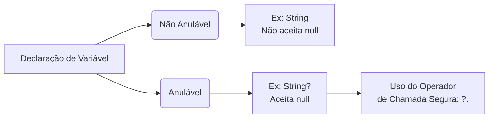

# 📚 Resumo 04 - Operadores e Conversão de Tipos em Kotlin

---

## 🎯 Objetivos da Aula

* Compreender os principais operadores aritméticos, relacionais e lógicos.
* Utilizar operadores para realizar cálculos e comparar valores.
* Compreender as conversões explícitas entre tipos de dados.
* Identificar as principais diferenças entre Kotlin e Java na conversão de tipos.
* Conhecer o conceito de *nullability* e a sua importância na prevenção de erros.

---

## 🧮 Operadores em Kotlin

Os operadores permitem realizar operações sobre valores e variáveis, como cálculos matemáticos, comparações e avaliações lógicas.

### 1. Operadores Aritméticos

São utilizados para realizar operações matemáticas básicas.

| Operador | Operação | Exemplo | Resultado |
| --- | --- | --- | --- |
| `+` | Adição | `10 + 3` | `13` |
| `-` | Subtração | `10 - 3` | `7` |
| `*` | Multiplicação | `10 * 3` | `30` |
| `/` | Divisão | `10 / 3` | `3` |
| `%` | Resto da divisão | `10 % 3` | `1` |

> 💡 **Atenção**: Na divisão entre inteiros (`10 / 3`), o resultado também é inteiro (a parte decimal é descartada). Para obter um resultado decimal, pelo menos um dos números deve ser decimal (`10.0 / 3.0`). O operador `%` é muito útil para descobrir se um número é par (ex: `numero % 2 == 0`).

### 2. Operadores Relacionais

Permitem comparar dois valores. O resultado é sempre um `Boolean` (`true` ou `false`).

| Operador | Significado | Exemplo | Resultado |
| --- | --- | --- | --- |
| `==` | Igual a | `5 == 5` | `true` |
| `!=` | Diferente de | `5 != 3` | `true` |
| `>` | Maior que | `8 > 5` | `true` |
| `<` | Menor que | `3 < 5` | `true` |
| `>=` | Maior ou igual a | `5 >= 5` | `true` |
| `<=` | Menor ou igual a | `3 <= 5` | `true` |

> 🌐 **Contexto**: Em Kotlin, `==` verifica a **igualdade estrutural** (se os valores são iguais). Se precisares de verificar se duas referências apontam exatamente para o mesmo objeto na memória, deves utilizar o operador de identidade `===`.

### 3. Operadores Lógicos

Servem para combinar ou inverter expressões booleanas, utilizando avaliação de curto-circuito (*short-circuit*).

| Operador | Significado | Exemplo Prático |
| -- | --- | -- |
| `&&` | **E lógico**: *ambas* as condições devem ser verdadeiras | `idade >= 18 && temDocumento` |
| `\|\|` | **OU lógico**: *pelo menos uma* condição deve ser verdadeira | `idade < 18 || idade >= 65` |
| `!` | **Negação lógica**: inverte o resultado booleano | `!true` (resulta em `false`) |

---

## 🔄 Conversão de Tipos (Type Casting)

A conversão de tipos consiste em transformar um valor de um tipo de dados noutro. Em Kotlin, **não existem conversões numéricas implícitas** como no Java. Tudo deve ser feito de forma explícita.

### Funções de Conversão Numérica

| Função | Finalidade | Exemplo |
| --- | --- | --- |
| `toInt()` | Converter para número inteiro | `5.8.toInt()` ➔ `5` |
| `toDouble()` | Converter para número decimal | `5.toDouble()` ➔ `5.0` |
| `toFloat()` | Converter para Float | `5.toFloat()` ➔ `5.0f` |
| `toLong()` | Converter para inteiro de maior capacidade | `5.toLong()` ➔ `5L` |

### Conversão entre Texto e Números

Para converter uma `String` num número, utilizamos o `.toInt()`. No entanto, se o texto não for um número válido, o programa falha (lança uma exceção `NumberFormatException`).

Para evitar a falha, utilizamos **`toIntOrNull()`**:

```kotlin
val texto = "vinte e cinco"
val idade = texto.toIntOrNull()

println(idade) // Resultado: null (não falha, apenas devolve nulo)

```

---

## 🛡️ Introdução à Nullability (Segurança Nula)

Em programação, `null` representa a ausência de um valor (o famoso causador do `NullPointerException`). O Kotlin foi desenhado para evitar este erro, distinguindo claramente os tipos que aceitam `null` dos que não aceitam.



### Tipos Não Anuláveis vs Anuláveis

* **Não Anulável (Por defeito)**: `val nome: String = "Ana"` (Se tentares atribuir `null`, o código nem sequer compila).
* **Anulável (Com `?`)**: `val nome: String? = null` (O sinal de interrogação indica que a variável pode estar vazia).

### O Operador de Chamada Segura `?.`

Quando uma variável pode conter `null`, aceder diretamente aos seus métodos pode causar erros. O operador `?.` permite aceder a propriedades apenas se o valor **não for nulo**:

```kotlin
val nome: String? = null
println(nome?.length) // Não dá erro. Simplesmente imprime: null

```

---

### 🎯 Desafio Prático

Cria um programa Kotlin que cumpra os seguintes passos:

1. Declare dois números inteiros.
2. Apresente a sua soma, subtração, multiplicação e divisão.
3. Compare os números e indique se são iguais (usando `==`).
4. Verifique se o primeiro número é par (utilizando o operador `%`).
5. Declare uma `String` com o valor `"42"` e converta-a para `Int`.
6. Declare uma variável `String?` com o valor `null` e apresente o resultado de uma chamada segura à propriedade `length`.

**Desafio Bónus**: Utiliza operadores lógicos (`&&`) para verificar se o primeiro número é **positivo** (maior que zero) **E** **par** ao mesmo tempo!