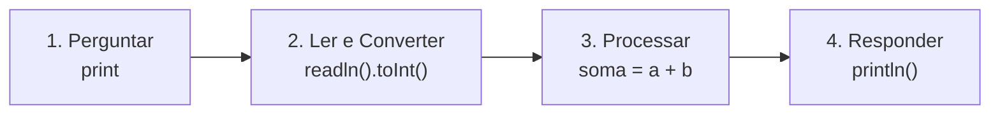

# 📚 Resumo 05 - Entrada e Saída de Dados em Kotlin

---

## 🎯 Objetivos da Aula

* Compreender a utilização de `print()` e `println()` para apresentar informações.
* Aprender a ler dados introduzidos pelo utilizador com `readln()`.
* Armazenar dados de entrada em variáveis para processamento.
* Converter entradas de texto (String) para tipos numéricos e outros tipos de dados.
* Desenvolver pequenos programas interativos em Kotlin.

---

## 🖨️ Saída de Dados: `print()` vs `println()`

A saída de dados permite apresentar informações ao utilizador na consola. Em Kotlin, utilizamos principalmente duas funções, com uma diferença fundamental de formatação:

| Função | Comportamento | Exemplo | Resultado Visual |
| --- | --- | --- | --- |
| **`print()`** | Apresenta o conteúdo e **mantém o cursor na mesma linha**. | `print("Olá, ")`<br>

<br>`print("mundo!")` | `Olá, mundo!` |
| **`println()`** | Apresenta o conteúdo e **muda para a linha seguinte**. | `println("Olá,")`<br>

<br>`println("mundo!")` | `Olá,`<br>

<br>`mundo!` |

---

## ⌨️ Entrada de Dados: `readln()`

A entrada de dados permite que o programa receba informações digitadas pelo utilizador (normalmente através do teclado).

```kotlin
print("Qual é o teu nome? ")
val nome = readln()
println("Olá, $nome!")

```

> ⚠️ **Regra de Ouro**: A função `readln()` aguarda que o utilizador digite algo e prima a tecla *Enter*. No entanto, o valor devolvido por `readln()` é **SEMPRE** do tipo `String` (texto), mesmo que o utilizador digite apenas números.

---

## 🔄 Conversão de Dados de Entrada

Como `readln()` devolve sempre texto (`String`), precisamos de converter esse texto quando queremos fazer cálculos matemáticos ou avaliações lógicas.

### Funções de Conversão Comuns

| Tipo Pretendido | Função de Conversão | Exemplo de Uso | Observação |
| --- | --- | --- | --- |
| **String** | *(Não necessita)* | `val nome = readln()` | Lê o texto exatamente como foi digitado. |
| **Int** | `.toInt()` | `val idade = readln().toInt()` | Falha e lança uma exceção se a entrada contiver letras. |
| **Double** | `.toDouble()` | `val preco = readln().toDouble()` | Espera um ponto `.` como separador decimal (ex: `19.99`). |
| **Boolean** | `.toBoolean()` | `val ativo = readln().toBoolean()` | Só devolve `true` se o texto for `"true"`. Qualquer outro texto devolve `false`. |

### Conversão Segura com `toIntOrNull()`

Se o utilizador digitar "abc" quando pedimos a idade, a função `.toInt()` fará o programa estourar (lançando um `NumberFormatException`). Para evitar isso, utilizamos a **conversão segura**:

```kotlin
print("Introduz um número inteiro: ")
val numero = readln().toIntOrNull() // Se digitar letras, devolve 'null' em vez de erro
```

---

## 💻 Criando um Programa Interativo

Um programa interativo junta entrada, processamento e saída. O fluxo típico é:



**Exemplo Completo:**

```kotlin
print("Introduz o primeiro número: ")
val numero1 = readln().toInt()

print("Introduz o segundo número: ")
val numero2 = readln().toInt()

val soma = numero1 + numero2
println("A soma de $numero1 e $numero2 é $soma.")
```

---

### 🎯 Desafio Prático

Desenvolve um programa Kotlin que faça o seguinte:

1. Solicite o nome do utilizador.
2. Solicite a sua idade.
3. Solicite dois números inteiros.
4. Apresente uma mensagem de boas-vindas com o nome e a idade.
5. Mostre a soma dos dois números introduzidos.

**Desafio Bónus**: Na leitura dos dois números inteiros, tenta utilizar o `.toIntOrNull()` em vez do `.toInt()`. Como ainda não estudamos as condições (`if`/`else`), foca-te apenas em observar o que acontece se digitares letras em vez de números na hora de somar. (O resultado passará a envolver *nulls*!).