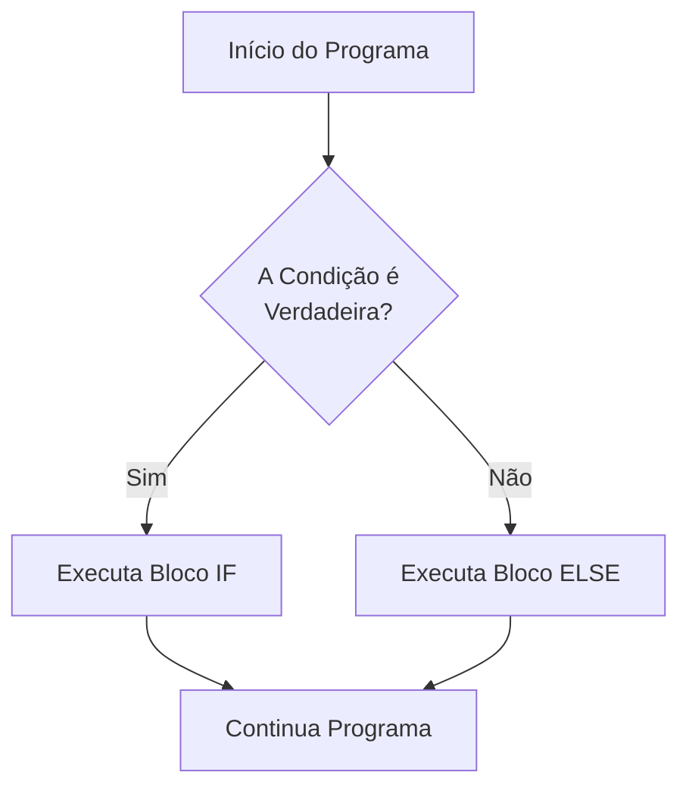

# 📚 Resumo 06 - Estruturas Condicionais em Kotlin

---

## 🎯 Objetivos da Aula

* Compreender como funcionam as estruturas condicionais.
* Utilizar `if` e `else` para tomar decisões lógicas.
* Utilizar a estrutura `when` para avaliar diferentes alternativas.
* Compreender que, em Kotlin, as estruturas condicionais podem ser usadas como *expressões* que devolvem valores.
* Aplicar condições e operadores lógicos em programas práticos.

---

## 🔀 O Que São Estruturas Condicionais?

As estruturas condicionais permitem que um programa tome decisões com base em determinadas condições. Em vez de executar o código sempre de cima a baixo de forma linear, o programa "escolhe" qual o caminho a seguir com base no resultado de uma expressão booleana (`true` ou `false`).



---

## ⚖️ A Estrutura `if` e `else`

### 1. Apenas `if`

Executa um bloco de código **apenas** quando a condição é verdadeira.

```kotlin
val idade = 20
if (idade >= 18) {
    println("É maior de idade.")
}

```

### 2. `if` e `else`

O `else` define o caminho alternativo caso a condição do `if` seja falsa.

```kotlin
val idade = 16
if (idade >= 18) {
    println("É maior de idade.")
} else {
    println("É menor de idade.") // Este bloco será executado
}

```

### 3. Várias condições: `else if`

Para encadear várias verificações por ordem, utilizamos o `else if`. O programa executa apenas o **primeiro bloco** cuja condição seja verdadeira.

```kotlin
val nota = 14
if (nota >= 18) {
    println("Excelente!")
} else if (nota >= 10) {
    println("Aprovado.") // Executa este e sai da estrutura
} else {
    println("Reprovado.")
}

```

> ⚠️ **Atenção à Ordem**: O programa avalia de cima para baixo. Se uma condição mais abrangente for colocada primeiro, poderá impedir que as condições seguintes sejam avaliadas.

---

## 🔠 A Estrutura `when`

O `when` é a alternativa do Kotlin (muito mais poderosa) ao clássico `switch` de outras linguagens. É ideal para escolher entre várias alternativas baseadas no mesmo valor.

### Comparar Valores Exatos

O operador `->` separa o valor a verificar da instrução a executar. O `else` funciona como a opção final (caso nenhum corresponda).

```kotlin
val dia = 3
when (dia) {
    1 -> println("Segunda-feira")
    2 -> println("Terça-feira")
    3 -> println("Quarta-feira") // Executa este
    else -> println("Dia não reconhecido")
}

```

### Agrupar Vários Valores

Podes agrupar alternativas separando-as por vírgulas.

```kotlin
when (dia) {
    1, 2, 3, 4, 5 -> println("Dia útil")
    6, 7 -> println("Fim de semana")
    else -> println("Dia inválido")
}

```

### O `when` Sem Parâmetros (Substituir cadeias de `if`)

Se omitires o valor entre parênteses, o `when` avalia condições booleanas livres, substituindo de forma elegante uma cadeia complexa de `else if`.

```kotlin
val nota = 17
when {
    nota >= 18 -> println("Excelente!")
    nota >= 10 -> println("Aprovado.")
    else -> println("Reprovado.")
}

```

---

## 🔄 Condicionais como Expressões

Uma funcionalidade fantástica do Kotlin é que tanto o `if` como o `when` **podem devolver um valor**, sendo diretamente atribuídos a uma variável. Isto evita a repetição de código.

### `if` como Expressão

Para usar o `if` como expressão, é **obrigatório** ter um bloco `else`, garantindo que um valor é sempre devolvido.

```kotlin
val idade = 20
val categoria = if (idade >= 18) "Adulto" else "Menor"
println(categoria) // Imprime: Adulto

```

### `when` como Expressão

```kotlin
val nota = 15
val resultado = when {
    nota >= 18 -> "Excelente"
    nota >= 10 -> "Aprovado"
    else -> "Reprovado"
}
println(resultado) // Imprime: Aprovado

```

---

## 🧮 Operadores Utilizados nas Condições

| Operador | Significado | Exemplo |
| --- | --- | --- |
| `==` | Igual a | `idade == 18` |
| `!=` | Diferente de | `idade != 18` |
| `>` | Maior que | `nota > 10` |
| `<` | Menor que | `idade < 18` |
| `>=` | Maior ou igual a | `nota >= 10` |
| `<=` | Menor ou igual a | `idade <= 18` |
| `&&` | **E** lógico (ambas verdadeiras) | `idade >= 18 && idade < 65` |
| `\|\|` | **Ou** lógico (pelo menos uma verdadeira) | `dia == 6 || dia == 7` |
| `!` | **Negação** lógica | `!temCartao` |

> 💡 **Boa Prática**: Não confundas `=` (atribuição de valor a uma variável, ex: `val a = 5`) com `==` (comparação de igualdade, ex: `if (a == 5)`).

---

### 🎯 Exercícios de Consolidação

Pratica o que aprendeste tentando resolver os seguintes desafios sem olhar imediatamente para as soluções:

1. **Maioridade:** Solicita a idade do utilizador com `readln().toInt()` e apresenta se é maior ou menor de idade.
2. **Classificação de uma Nota:** Solicita uma nota (0-20) e apresenta: "Excelente" (>= 18), "Aprovado" (10-17) ou "Reprovado" (< 10).
3. **Dia da Semana:** Solicita um número (1-7) e utiliza o `when` para apresentar o dia correspondente. Trata as entradas inválidas com o bloco `else`.
4. **Expressão Condicional:** Lê dois números inteiros e utiliza um `if` como *expressão* para guardar numa nova variável chamada `maior` qual o maior dos dois números, imprimindo-a no final.

🔥 **Desafio Final (Calculadora Simples):**
Solicita dois números e um símbolo de operação (+, -, *, /) como `String`. Utiliza o `when` para avaliar o símbolo digitado, realiza o cálculo matemático correspondente e imprime o resultado. Não te esqueças de tratar o caso de divisão por zero!