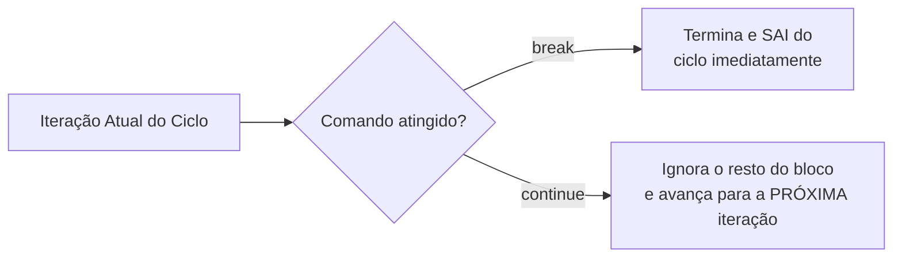

# 📚 Resumo 07 - Estruturas de Repetição em Kotlin

---

## 🎯 Objetivos da Aula

* Compreender como repetir instruções com `for`, `while` e `do-while`.
* Utilizar intervalos com `..` e `until`.
* Percorrer intervalos e coleções com o operador `in`.
* Controlar a execução de ciclos com `break` e `continue`.
* Resolver problemas utilizando contadores e acumuladores.

---

## 🔄 O Que São Estruturas de Repetição (Ciclos)?

As estruturas de repetição (também chamadas de *loops* ou ciclos) permitem executar um bloco de código várias vezes sem precisar de escrever as mesmas instruções repetidamente.

Em Kotlin, existem três estruturas principais, escolhidas consoante a necessidade do problema:

| Estrutura | Quando utilizar | Verificação da condição |
| --- | --- | --- |
| **`for`** | Percorrer intervalos conhecidos, sequências ou coleções. | Controlada pela própria sequência. |
| **`while`** | Repetir um bloco *enquanto* uma condição for verdadeira. | **Antes** da execução do bloco. |
| **`do-while`** | Executar *pelo menos uma vez* e repetir enquanto for verdadeira. | **Depois** da execução do bloco. |

---

## 🔁 O Ciclo `for` (Intervalos e Percursos)

O ciclo `for` em Kotlin é ideal para iterar sobre valores. O operador `in` indica que vamos percorrer os elementos, e os **intervalos** definem as regras desse percurso:

| Operador / Comando | Ação | Exemplo prático | Valores Percorridos |
| --- | --- | --- | --- |
| `..` | Intervalo inclusivo (inclui o fim) | `1..5` | `1, 2, 3, 4, 5` |
| `until` | Intervalo exclusivo (exclui o fim) | `1 until 5` | `1, 2, 3, 4` |
| `downTo` | Ordem decrescente | `5 downTo 1` | `5, 4, 3, 2, 1` |
| `step` | Define o tamanho do "salto" | `0..10 step 2` | `0, 2, 4, 6, 8, 10` |

**Exemplo Prático:**

```kotlin
for (numero in 1..5) {
    println(numero)
}

```

---

## ⏳ Os Ciclos `while` e `do-while`

### O Ciclo `while`

Avalia a condição logo no início. Se for falsa à partida, o bloco de código **nunca** é executado.

```kotlin
var contador = 1
while (contador <= 5) {
    println(contador)
    contador++ // Essencial para evitar um "ciclo infinito"!
}

```

### O Ciclo `do-while`

Garante que o código é executado **pelo menos uma vez**, porque a condição só é avaliada no final. É ideal para pedir dados ao utilizador e verificar se estão corretos.

```kotlin
var opcao: String
do {
    println("Escreva 'sair' para terminar:")
    opcao = readln()
} while (opcao != "sair")

```

---

## 🛑 Controlo de Ciclos: `break` e `continue`

Estas palavras-chave servem para alterar o comportamento natural de um ciclo quando uma condição especial acontece.



* **`break`**: Destrói o ciclo naquele momento. Os valores que faltavam percorrer são ignorados.
* **`continue`**: Salta apenas a iteração atual. O ciclo continua a funcionar para o próximo valor.

---

## 🧮 Contadores e Acumuladores

São variáveis extremamente comuns dentro de ciclos (devem ser declaradas como `var` **antes e fora** do ciclo para não perderem o valor a cada repetição).

* **Contador**: Conta ocorrências. Normalment aumenta de 1 em 1 (`contador++`).
* **Acumulador**: Soma ou junta valores progressivamente. Utiliza o operador `+=` (`soma += numero`).

**Exemplo: Calculando a média de 5 números:**

```kotlin
var soma = 0      // Acumulador
var contador = 0  // Contador

for (numero in 1..5) {
    soma += numero // Acumula o valor atual
    contador++     // Conta mais uma iteração
}

val media = soma.toDouble() / contador
println("Média: $media")

```

---

### 🎯 Desafio Prático (Média de Notas com Validação)

Cria um programa que cumpra os seguintes passos:

1. Solicite 5 notas (valores de 0 a 20) ao utilizador utilizando um ciclo `for`.
2. Utilize um **acumulador** para somar todas as notas introduzidas.
3. Utilize um **contador** para registar quantas dessas notas são iguais ou superiores a 10 (positivas).
4. No final do ciclo, calcula e apresenta a média das notas.
5. Apresenta a quantidade de notas positivas registadas.

🔥 **Desafio Bónus**: Adiciona um ciclo `do-while` *dentro* do teu ciclo `for`! Este ciclo deve servir para validar a entrada: o programa deve ficar "preso" a pedir a nota daquela iteração enquanto o utilizador introduzir um valor inválido (menor que 0 ou maior que 20).